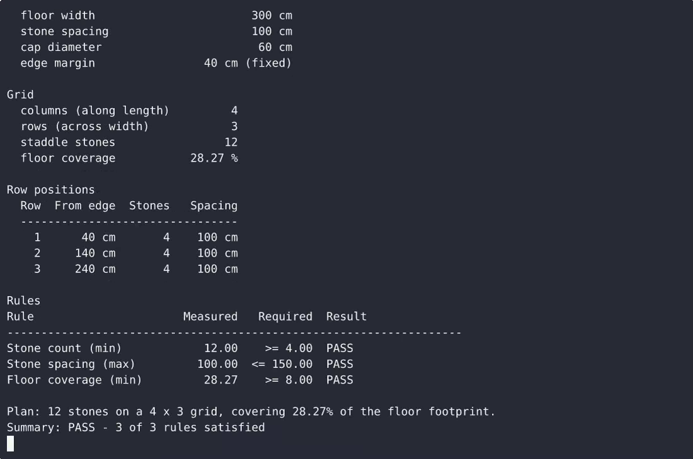
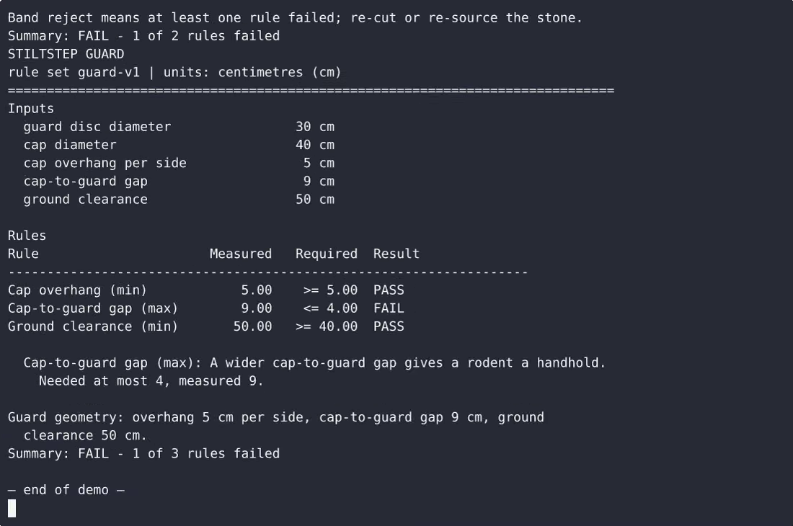

# Stiltstep — complete Full-stack app command-line tool example app

Stiltstep is a single-file, standard-library-only Python command-line tool that runs three practical checks on a granary staddle-stone setup: `stiltstep grade` scores one staddle stone's height-to-cap-diameter proport…. That's **Stiltstep** — a Apache-2.0-licensed, open-source command-line tool in Full-stack app you can self-host and modify freely. Fork Stiltstep, run it, or [remix it on cenius.ai](https://cenius.ai/marketplace/p/stiltstep?ref=gh&utm_campaign=stiltstep-webapp) for a custom Stiltstep build with full rebrand rights.


[](LICENSE)  [](https://cenius.ai)

[](https://cenius.ai/marketplace/p/stiltstep?ref=gh&utm_campaign=stiltstep-webapp)

> **▶ [Open & edit in cenius.ai](https://cenius.ai/marketplace/p/stiltstep?ref=gh&utm_campaign=stiltstep-webapp)** — one click to an editable workspace: describe changes in plain English, get an instant preview, one-click deploy and host. Modifications made on the platform come with full rebrand & relicense rights.

_Local clone? See [Quick start](#quick-start) below. cenius.ai is the zero-setup path._

## Demo


▶ **[See it in action](https://cenius.ai/marketplace/p/stiltstep?ref=gh&utm_campaign=stiltstep-webapp)** — full demo on the project page · [MP4](.github/media/demo.mp4)

## Screenshots

 

## Quick start

```bash
./install.sh   # installs dependencies + seeds demo data
```

See [`INSTALL.md`](INSTALL.md) for full setup and usage instructions.

## Features

- Staddle stone grading
- Granary floor layout planning
- Rodent guard checks
- Built-in defaults with runtime threshold overrides
- Plain-text report and exit-code contract
- Input validation and usage errors

## Architecture

A self-contained Full-stack app project (22 files): top-level directories include `tests/`. Starting up is just `./install.sh`: it installs what is needed and pre-fills the database so you have data to work with straight away. Full setup details: [`INSTALL.md`](INSTALL.md).

## Usage guide

Three checks, one report format, one exit-code contract. Every dimension is in
centimetres.

```
python3 stiltstep.py CHECK [options]
```

Run it as `python3 stiltstep.py ...` from the project directory, or as
`stiltstep ...` after `bash install.sh`.

### grade - one staddle stone

```
$ python3 stiltstep.py grade --height 60 --cap-diameter 45 --base-diameter 30

STILTSTEP GRADE
rule set grade-v1 | units: centimetres (cm)
==============================================================================
Inputs
  height                             60 cm
  cap diameter                       45 cm
  base diameter                      30 cm
  height/cap ratio                    1.33
  base/cap ratio                      0.67

Rules
Rule                      Measured   Required  Result
-------------------------------------------------------------------
Height/cap ratio (min)        1.33    >= 0.90  PASS
Height/cap ratio (max)        1.33    <= 2.20  PASS
Base/cap ratio (min)          0.67    >= 0.55  PASS

Grade band: A   score: 100.0 of 100
Band A means well proportioned, no reservations.
Summary: PASS - 3 of 3 rules satisfied
```

- `--base-diameter` is optional. Without it the base rule is skipped and the
  skipped rule is named under the table.
- The band is `A`, `B`, `C` or `reject`. Any failed rule means `reject` and
  exit code 1, however good the score is.
- The score is the weighted quality of the measurements out of 100: full marks
  once a measurement is clear of its threshold by the comfort factor, 70 at the
  threshold itself.

A stone that fails:

_Full guide: [`USAGE.md`](USAGE.md)_

## FAQ

### How do I self-host Stiltstep?

Grab the repo and run `./install.sh` — it handles packages and seed data in one go. After that, [`INSTALL.md`](INSTALL.md) walks you through starting the server. No external accounts required.

### How can I customize Stiltstep without editing code?

Open it on [cenius.ai](https://cenius.ai/marketplace/p/stiltstep?ref=gh&utm_campaign=stiltstep-webapp) and describe the changes you want in plain English — the platform modifies the app and gives you a new, downloadable build.

### What license does Stiltstep use?

It is. Apache-2.0 licensing means you can build a product on it, sell it, or use it inside a company with no fees. Details: [LICENSE](LICENSE).

### How do I customise Stiltstep's branding?

Rebranding is straightforward under the MIT license — change what you want in the source. Or [open it on cenius.ai](https://cenius.ai/marketplace/p/stiltstep?ref=gh&utm_campaign=stiltstep-webapp): the platform handles the changes and grants full rebrand rights on the result.

### Which technology stack does Stiltstep use?

Full-stack app end-to-end. Every file you need to run the app is here in this repository — code, configuration, seed data. Highlights include rodent guard checks.

## License & rebranding

Released under the [Apache License 2.0](LICENSE) (© 2026 Cenius AI) — free for personal and commercial use. The Cenius name/logo are trademarks (see NOTICE).

**Need a customized version?** [Remix this app on cenius.ai](https://cenius.ai/marketplace/p/stiltstep?ref=gh&utm_campaign=stiltstep-webapp) — modifications made on the platform come with **full rebrand & relicense rights** over your derivative.

## Built with cenius.ai

This entire application — code, design, seeded demo data — was generated on **[cenius.ai](https://cenius.ai)** from a plain-English description.

- 🚀 [Build your own app on cenius.ai](https://cenius.ai)
- 🎛️ [Remix Stiltstep on the marketplace](https://cenius.ai/marketplace/p/stiltstep?ref=gh&utm_campaign=stiltstep-webapp) — open it in a workspace, prompt for changes, and ship your own version.

More open-source apps: [the Cenius-ai catalog](https://github.com/Cenius-ai) · [showcase index](https://github.com/Cenius-ai/showcase)
